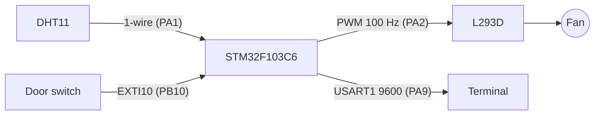

# Smart Greenhouse (Bare-Metal STM32F1)


A small greenhouse controller for the STM32F103, written entirely at register level (CMSIS only, no HAL). It reads temperature and humidity from a **DHT11** with a hand-written single-wire driver, sets a fan's speed by **PWM** in proportion to humidity, and raises a **door alarm** through an external interrupt. Status is streamed over UART. The design was built and tested in a **Proteus** simulation.

## Features

- **DHT11 driver**: start pulse, response check, 40-bit read using SysTick microsecond delays, timeout on every wait, checksum and all-zero reading rejection, numbered error codes
- **Fan control**: TIM2 CH3 PWM at 100 Hz; duty = humidity % (`CCR3 = humidity × 10`)
- **Door alarm**: falling edge on PB10 (EXTI10) immediately stops the fan and prints an alarm
- **UART telemetry** every 2 s: temperature, humidity, fan power or DHT11 error code

## Hardware (Proteus model)

| Part | Notes |
|---|---|
| STM32F103C6 | Runs on the 8 MHz HSI clock |
| DHT11 | Temperature / humidity |
| L293D + DC fan motor | PWM on EN1 |
| Push button / door switch | To GND, internal pull-up |
| Virtual terminal | 9600 baud, 8N1 |

### Wiring

| Signal | STM32 pin | Connects to |
|---|---|---|
| DHT11 data (open-drain) | PA1 | DHT11 DATA |
| TIM2_CH3 (PWM) | PA2 | L293D EN1 |
| EXTI10 (input, pull-up, falling edge) | PB10 | Door switch |
| USART1_TX | PA9 | Virtual terminal RX |



<!-- Proteus schematic screenshot: add docs/proteus.png and reference it here -->

## DHT11 error codes

| Code | Meaning |
|---|---|
| 11–13 | No response / handshake timeout |
| 14–15 | Timeout while reading a bit |
| 16 | Checksum error |
| 17 | All-zero reading rejected |

## Build

Requires the [Arm GNU Toolchain](https://developer.arm.com/downloads/-/arm-gnu-toolchain-downloads) (`arm-none-eabi-gcc`) and GNU Make.

```bash
make            # -> build/Smart_Greenhouse_BareMetal.elf / .bin
```

In Proteus, set the STM32F103C6 component's *Program File* to `build/Smart_Greenhouse_BareMetal.elf`. On real hardware, flash it with an ST-LINK (`make flash`).

## Known limitations

- The door alarm stops the fan only until the next DHT11 cycle (≤ 2 s), when the main loop writes a new duty value; a latched alarm state would keep it off.
- DHT11 reads and delays are blocking.

---

### 🇹🇷 Türkçe özet

STM32F103C6 için HAL kullanmadan register düzeyinde yazılmış **akıllı sera** denetleyicisi; **Proteus**'ta simüle edildi. DHT11 sensörü SysTick mikro-saniye gecikmeleriyle elle yazılmış tek hat sürücüsüyle okunuyor (zaman aşımı, checksum, hata kodları). Fan hızı TIM2 CH3 PWM ile neme orantılı ayarlanıyor; PB10'daki kapı anahtarı EXTI kesmesiyle fanı durdurup alarm veriyor. Durum USART1 (PA9, 9600) üzerinden terminale basılıyor.
